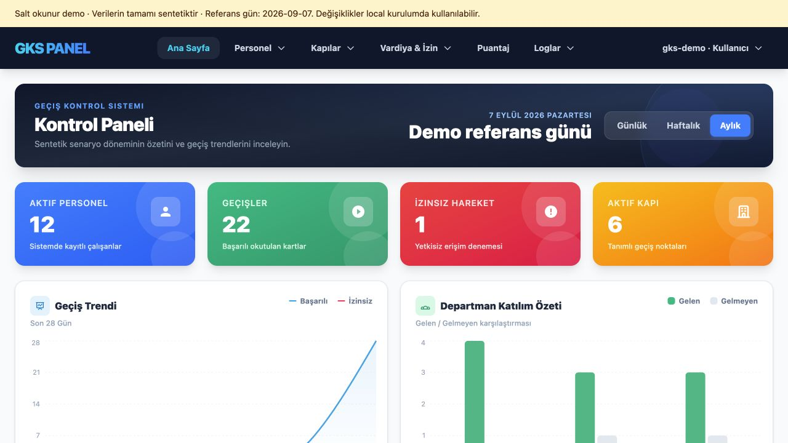
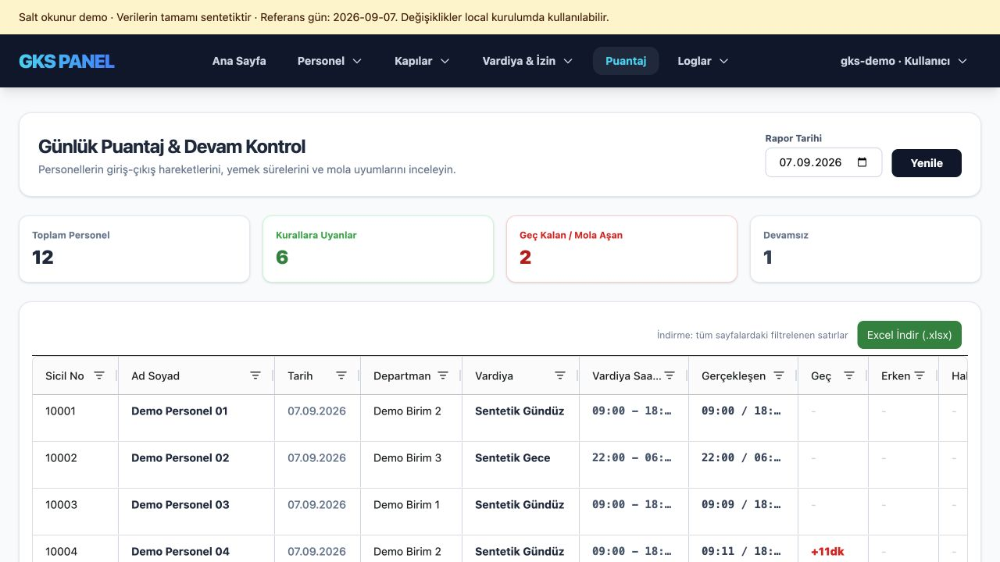
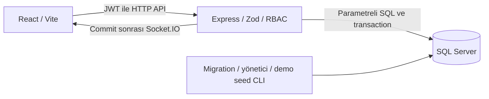

# GKS

GKS; personel, kapı yetkisi, vardiya, izin ve devam/mesai akışlarını bir araya getiren bağımsız, kişisel bir full-stack portföy projesidir. Fiziksel cihaz katmanı sentetik geçiş kayıtlarıyla temsil edilir; uygulama ticari bir erişim kontrol ürünü değildir.

V1 hazırlanıyor. Salt okunur demo modu yerelde çalışıyor; public HTTPS demo adresi henüz yayınlanmadı. Tam yönetim işlemleri için aşağıdaki yerel kurulum kullanılabilir.

React/Vite arayüzü, Express API, SQL Server ve Socket.IO kullanır. Puantaj/gece vardiyası hesabı, transaction ile audit tutarlılığı, rol denetimi, geçmiş kayıtların korunması ve tekrar üretilebilir sentetik veri projenin temel teknik konularıdır.

## Lisans

GKS, **PolyForm Internal Use 1.0.0 + kişisel öğrenme ek izni** ile sunulur. Öğrenciler ve bireyler ticari olmayan özel öğrenme çalışmaları için kullanabilir ve değiştirebilir; şirket içi kullanım da serbesttir. Orijinal veya değiştirilmiş yazılımın üçüncü kişilere dağıtılması, satılması ya da hizmet olarak sunulması için izin verilmez. [Bağlayıcı koşullar](LICENSE), [standart lisans metni](docs/licenses/PolyForm-Internal-Use-1.0.0.md) ve [Türkçe açıklama](docs/lisans-kullanimi.md). Üçüncü taraf bağımlılıkların lisansları ayrıdır.

## Demo görselleri

Yerel salt okunur demodan alınmıştır; bütün kişi, kapı ve hareket kayıtları sentetiktir. Referans gün 7 Eylül 2026’dır.





## Mimari



Geliştirmede Vite istekleri backend'e yönlendirir. Docker düzeninde nginx derlenmiş arayüzü sunar ve API/Socket.IO bağlantılarını backend'e taşır. SQL ayrı yönetilir. Fiziksel kart okuyucu veya kapı açma bağlantısı yoktur.

[Hesaplama kuralları](docs/V1-hesaplama-kurallari.md), tolerans, gece vardiyası, eksik okutma, yemek/mola ve haftalık tatil örneklerini açıklar.

[Veri modeli](docs/V1-veri-modeli.md), temel tabloları, ilişkileri ve migration sırasını açıklar.

## Yerel çalışma

Node.js 24 ve erişilebilir SQL Server gerekir. İki klasörde `npm ci` çalıştırın. Her klasörün `.env.example` dosyasını `.env` olarak kopyalayıp backend bağlantısını ve güçlü, rastgele `JWT_SECRET` değerini doldurun. Bu dosyaları Git'e eklemeyin.

Boş veritabanı için backend klasöründe:

```sh
npm run db:init
npm run db:migrate
npm run admin:create
```

İlk yönetici komutu `BOOTSTRAP_USERNAME` ve `BOOTSTRAP_PASSWORD` ortam değişkenlerini kullanır; parola en az 10 karakter, UTF-8 kodlamasında en fazla 72 bayt olmalıdır (bcrypt sınırı). Mevcut hesap varsa yeni kurulum yapmaz. Veritabanı oluşturma/güncelleme için kullanılan yetkili hesabı normal uygulama hesabından ayırın.

Normal servis hesabı için [uygulama veritabanı rolünü](docs/database-roles.md) kurulumdan sonra yapılandırın. `db:runtime-role` yalnız gerekli iş tablosu izinlerini verir; migration ve şema yetkileri kurulum hesabında kalır.

Mevcut veritabanında önce yedek alın ve ayrı veritabanına geri yükleyerek doğrulayın. `db:migrate` komutunu önce bu kopyada deneyin. Uyumsuz kayıtlar otomatik silinmez; güncelleme hata verirse veriyi inceleyin.

İki terminalde:

```sh
npm start --prefix gks_backend
npm run dev --prefix gks_frontend
```

Arayüz: http://localhost:5173. Vite `/api` ve `/socket.io` isteklerini backend'e yönlendirir. Uygulama varsayılan olarak yalnızca yerel bilgisayardan erişilir.

Docker ile tam yerel kurulum için [boş DB → migration → ilk yönetici → isteğe bağlı seed → nginx](docs/local-docker.md) adımlarını izleyin. Yerel kullanım `compose.local.yaml` ekini açıkça seçer; public/üretim kurulumu yalnız `compose.yaml` kullanır.

## Kontroller

```sh
npm test --prefix gks_backend
npm test --prefix gks_frontend
npm run lint --prefix gks_frontend
npm run build --prefix gks_frontend
npm audit --prefix gks_backend
npm audit --prefix gks_frontend
```

Veritabanı testleri varsayılan olarak atlanır. Yerel SQL Server bağlantısını backend `.env` dosyasında hazırlayıp proje kökünden çalıştırın:

```sh
npm run test:db --prefix gks_backend
```

Her test grubu rastgele adlı yeni bir `GksTest_` veritabanı oluşturur, gerçek migration komutunu iki kez çalıştırır ve kendi sentetik hesap/personel/vardiya kayıtlarını hazırlar. Hazır demo hesabı, eski parola veya yedekten geri yükleme gerekmez. `.env` içindeki `DB_NAME` test veya temizlik hedefi olarak kullanılmaz. SQL bağlantı hesabı veritabanı oluşturma ve kaldırma yetkisine sahip olmalıdır; yalnız geliştirme SQL sunucusu kullanın. `NODE_ENV=production` ile testler reddedilir.

Temizlik yalnız o çalıştırmanın oluşturduğu veritabanını kaldırır; başarısız testte de çalışır. Süreç zorla öldürülürse geçici DB kalabilir; araç sonraki çalıştırmada eski DB'leri otomatik silmez. Tek grubu çalıştırmak için backend klasöründe `RUN_DB_TESTS=true node --test test/integration.test.js` veya `RUN_SIM_TESTS=true node --test test/seeder.test.js` kullanılabilir.

GitHub Actions yapılandırması birim testlerini, kod kontrolünü, derlemeyi ve bağımlılık denetimini içerir. Ayrı SQL işi, geçici SQL Server 2022 Developer servisi hazır olduğunda temiz kurulum/migration, API, demo ve canlı bağlantı testlerini çalıştırır; backend/frontend Docker imajlarını derler ve migration dosyalarının backend imajına dahil olduğunu denetler. Bu işteki parola yalnız geçici CI servisine ait örnektir; gerçek ortam secret'ı kullanılmaz. Her test grubu yine kendi veritabanını oluşturup kaldırır. SQL Server 2022 üzerinde GitHub Actions çalıştırması henüz doğrulanmadı; yerel SQL ve Docker kontrolleri tamamlandı. Otomatik deployment yoktur.

## İşleyiş

- `admin` kayıtları yönetir. `user` rapor ve listeleri okuyabilir; değişiklik API'leri yönetici gerektirir.
- Parola değişikliği mevcut oturumları geçersiz kılar. Rol ve oturum sürümü API isteklerinde, açık socket bağlantılarında da düzenli kontrol edilir.
- Raporlar vardiyanın ertesi güne sarkan çıkışını, vardiya tarihçesini, onaylı izinleri ve personelin işe giriş/çıkış tarihlerini dikkate alır. Hesaplanan mesai ile onaylanan mesai ayrıdır; sıfır dakika onayı korunur.
- Mevcut SQL `datetime` kayıtları Türkiye yerel saatini temsil ediyor kabul edilir. Driver bunları UTC biçiminde taşısa da ekran tekrar üç saat eklemez. Gün seçimi `BUSINESS_TIMEZONE=Europe/Istanbul` kullanır. Gerçek cihaz zaman damgası entegrasyonu V1 kapsamı dışındadır.
- Simülasyon varsayılan kapalıdır, üretimde çalışmaz. Açılması için backend `ENABLE_SIMULATION=true`, frontend `VITE_ENABLE_SIMULATION=true` ve ayrı `GksReview_`/`GksTest_` veritabanı gerekir. Yalnızca ekleme yapar; mevcut geçmişi topluca silmez.

Yayın kapsamı ve geri dönüş adımları: [V1 sürüm notları taslağı](docs/V1-surum-notlari.md).


## Mesai karar sözleşmesi (V1)

Yeni izinlerde onaylı ve bekleyen kayıtların tarih aralığı, başlangıç ve bitiş günleri dahil çakışamaz; reddedilen izin engel oluşturmaz. Eski veride bir gün için birden fazla onaylı izin varsa puantaj keyfî olarak birini seçmez: **İzin Çakışması** gösterir, hesaplanan mesaiyi sıfır bırakır ve kayıtlar düzeltilene kadar yeni tekli/toplu mesai kararlarını 409 ile reddeder. Önceden kaydedilmiş mesai kararı silinmez. İzinler ekranı çakışan onaylı/bekleyen kayıtları işaretler; yanlış kayıt iptal edildiğinde rapor yeniden hesaplanır.

`Hesaplanan_Dk` sunucunun güncel vardiya/geçiş kayıtlarından hesapladığı süredir. `Onaylanan_Dk` yönetici kararındaki süredir; `Fazla_Mesai_Dk` yalnız onaylı kararda bu süreyi taşır, diğer durumlarda sıfırdır. Bu anlamlar günlük puantaj ve mesai listesinde aynıdır. Karar açıklaması, yapan hesap ve son karar zamanı `Mesai_Aciklama`, `Mesai_Islemi_Yapan`, `Mesai_Islem_Zamani` alanlarıyla döner. Mesai tablosu son kararı tutar. Bu sürümden itibaren her kararın önceki/yeni durumu, dakikaları ve açıklaması ayrıca Sistem ve İşlem Geçmişi ekranında `MESAİ KARARI` kaydı olarak saklanır; geçmişe dönük eski sürümler üretilmez.

Tekli ve toplu onay sırasında hesap aynı SQL transaction içinde yeniden yapılır. Eski istemcilerin gönderdiği `hesaplanan_dk` alanı isteğe bağlıdır ve hesap için kullanılmaz. Onaylanan süre tam sayı olarak **0 ile min(2880, hesaplanan + 120) dakika** arasında olabilir. Mevcut arayüzün 120 dakikalık yönetici düzeltme payı korunur. Red veya beklemeye alma onaylanan süreyi sıfırlar. Personel ilgili günün rapor kapsamında değilse 404, sınır aşımı veya yinelenen personel/gün satırı için 400 döner. Toplu işlemin herhangi bir satırı başarısızsa bütün işlem geri alınır. Aynı kişi için eşzamanlı kararlar sırayla uygulanır; son başarılı karar geçerlidir.

Mesai listesi pozitif hesaplanan süreleri ve daha önce karara bağlanmış kayıtları gösterir; sıfır onayı veya sonradan sıfırlanmış hesap nedeniyle red/bekleme kararı kaybolmaz. Rapor verileri değişirse onay anında kaydedilen hesap ile güncel rapor hesabı farklılaşabilir; geçmişte kullanılan verilerin kapsamı aşağıdaki geçmiş kayıt sözleşmesinde açıklanır.

## Excel indirme

Ortak veri tablolarındaki **Excel İndir (.xlsx)** düğmesi gerçek bir Office Open XML çalışma kitabı indirir. Görünen veri kolonlarının sırası, etkin kolon filtreleri ve sıralama korunur; işlem düğmeleri dosyaya alınmaz. Puantaj dosyası seçili rapor tarihini adında taşır.

Tarayıcıda sayfalanan tablolarda filtreye uyan bütün sayfalar; sunucu tarafından sayfalanan listelerde yalnız yüklenmiş sayfanın filtrelenen satırları indirilir. Kapsam düğmenin yanında belirtilir. Seçili satırlar ayrıca bir indirme filtresi değildir. Kullanıcı metinleri Excel formülü olarak yorumlanmaz; metin sicillerin baştaki sıfırları ve sayısal süreler korunur. Başlık satırı sabitlenir ve Excel otomatik filtresi eklenir. ExcelJS yalnız indirme sırasında yüklenir.

`npm test --prefix gks_frontend` çalışma kitabını yeniden okuyarak hücre türleri, Türkçe karakterler, sicil, tarih ve formül güvenliğini denetler; CI bu testleri de çalıştırır.

## Salt okunur sentetik demo kurulumu

Demo fiziksel cihaz bağlantısı olmayan, kişisel portföy amaçlı bir inceleme ortamıdır. Normal local kurulumda `DEMO_MODE=false` kalır ve yönetici işlemleri kullanılabilir.

Ayrı demo için backend `.env` dosyasında bağlantıyı **yeni ve boş** `GksDemo_V1` veritabanına yönlendirin (`DB_NAME=GksDemo_V1`). `DEMO_MODE=true`, `DEMO_SEED_CONFIRM=GksDemo_V1`, `ENABLE_SETUP=false` ve `ENABLE_SIMULATION=false` ayarlayın. Güçlü `JWT_SECRET` ve bağlantı bilgilerini kendi ortamınızda doldurun. Backend klasöründe:

```sh
npm run db:init
npm run db:migrate
npm run seed:demo
npm start
```

Frontend'i normal local çalışma komutuyla başlatın. “Demoyu İncele” düğmesi `user` rolünde kısa ömürlü oturum açar; paylaşılan yönetici parolası yoktur. `DEMO_USERNAME` değiştirilirse seed ve sunucuda aynı değer kullanılmalıdır. Mod sunucu başlangıcında okunur; değiştirdikten sonra backend yeniden başlatılır. Frontend demo bilgisini `/api/public-config` üzerinden alır; ayrıca bir frontend demo bayrağı gerekmez.

Seed 12 sentetik personel, iki vardiya, altı kapı, farklı yetki setleri, izin/mesai kararları ve örnek işlem geçmişi oluşturur. Referans gün **7 Eylül 2026**; haftalık tatil örneği 6 Eylül, gece vardiyasının çıkışı 8 Eylül'dür. Dashboard ve varsayılan tarih filtreleri bu dönemi kullanır. Aynı seed sürümü yeniden çalıştırıldığında kayıt çoğalmaz. Boş olmayan iş tabloları reddedilir; veriler otomatik silinmez. Baştan kurulum için yeni bir `GksDemo_` veritabanı adı seçilip hem `DB_NAME` hem `DEMO_SEED_CONFIRM` güncellenir ve komutlar tekrarlanır. Seed onay değişkeni normal servis çalışmasında gerekli değildir.

Demo modu bütün iş verisi yazma çağrılarını, admin tokenı kullanılsa bile `403 DEMO_READ_ONLY` ile reddeder. Giriş uçları açık kalır; seed yalnız CLI komutudur. Yerel geliştirme simülatörü demo seed'inden ayrıdır. Public HTTPS yayını henüz tamamlanmadı.

Backend Docker imajı proje kökünden `docker build -f gks_backend/Dockerfile -t gks-backend:local .` ile derlenir; migration klasörü imaja dahildir. Compose ayrı SQL Server bekler; SQL kurmaz veya mevcut DB'yi değiştirmez. Migration ve seed otomatik servis başlangıç adımları değildir. Üretim bağlantısında geçerli TLS sertifikalı SQL Server gerekir; localhost geliştirme sertifika ayarları üretim için kullanılmaz.

## Geçmiş kayıt sözleşmesi (V1)

- **Kart:** `Logs.User_ID`, okutma kaydı eklenirken kartın o andaki sahibine bağlanır. Kart numarası ayrıca olayın özgün verisi olarak saklanır. Sonraki kart değişikliği/devirleri eski geçişin sahibini değiştirmez. Tanımsız kartın kaydı `User_ID=NULL` kalır; kart daha sonra kaydedilse bile eski olayı sahiplenmez. Puantaj, log listesi ve dashboard kişi eşleştirmesinde bu sabit kimliği kullanır. Simülasyonun toplu eklemesi de SQL trigger'larını çalıştırır. Geçmiş zaman damgalı dış cihaz aktarımı için tarihsel kart sahipliği çözümü yoktur; V1 gerçek cihaz aktarımı sunmaz.
- **Vardiya:** `Personel_Vardiya` atama kaydı, o anki ad/saat/tolerans/mola/çalışma günü ayarlarının kopyasını taşır. Tanım düzenlemek mevcut atamaların hesabını değiştirmez. Yeni ayarları mevcut personele uygulamak için yeniden atama gerekir. Yeniden atama bugünden geçerlidir; mevcut aynı gün değiştirme/iptal kuralı korunur. Tamamlanmış önceki günler kendi atama ayarlarını kullanır.
- **Çalışma dönemleri:** Yeniden işe alma önceki dönemi `Personel_Calisma_Gecmisi` tablosuna arşivler ve güncel işe giriş tarihini bugüne taşır. Eski çalışma günleri raporda kalır; aradaki çalışılmayan günler dahil edilmez. Aynı gün çıkışın geri alınması o dönemi yeniden açar. Aynı durumu tekrar göndermek kayıt çoğaltmaz. Çıkış mevcut işe giriş ile bugün arasında olmalıdır. Personel düzenlemesinde yeni işe giriş önceki arşivli dönemle çakışamaz; gönderilmeyen kart ve işe giriş alanları korunur. Durum/arşiv/audit ve profil/audit işlemleri atomiktir.

`003_log_identity.sql` mevcut geçişleri **migration anındaki kart sahipleriyle**, `004_shift_snapshot.sql` eski atamaları **migration anındaki vardiya tanımlarıyla** eşleştirir. Önceden üzerine yazılmış kart sahipliği, vardiya tanımı veya çalışma dönemleri geri üretilemez. Bu başlangıç varsayımı mevcut sentetik geliştirme verisi içindir; doğrulanmamış gerçek geçmiş için doğruluk iddiası değildir. `005_employment_history.sql` sonraki çalışma dönemlerini saklamayı başlatır. Bu migration'lar eski şema üzerinde ve tekrar çalıştırma yoluyla izole testlerde doğrulanmıştır. Güncellemeden önce uygulamayı durdurun, `npm run db:migrate` çalıştırın ve güncel backend'i yeniden başlatın.


## Denetim kayıtları

Personel oluşturma/düzenleme, bireysel/toplu yetki-vardiya-durum işlemleri, izinler, kapılar, vardiya tanımları, mesai kararları, panel hesabı oluşturma/silme ve parola değişikliği kendi denetim kayıtlarıyla aynı transaction içinde tamamlanır. Denetim kaydı yazılamazsa iş değişikliği geri alınır. Socket bildirimleri commit sonrasında gönderilir. HTTP ve CLI ilk yönetici kurulumu da denetim kaydı oluşturur.

Parola, parola hash'i ve tokenlar audit detayına yazılmaz. Parola değişikliği oturum sürümünü artırır; aynı eski parola ile eşzamanlı değişikliklerden yalnız biri tamamlanabilir. Audit hata verirse parola ve oturum sürümü de geri alınır. Bu kayıtlar uygulama işlemlerinin geçmişidir; SQL yöneticisinin doğrudan müdahalesine karşı değiştirilemez arşiv veya harici güvenlik izleme sistemi değildir.

## API sözleşmesi ve sınırlar

Geliştirme ortamında backend'in `/api-docs` adresi OpenAPI arayüzünü açar; üretimde sunulmaz. Sözleşme `gks_backend/utils/swagger.js` içinde bütün API işlemlerini içerir. Route eklenip belgeye alınmazsa sözleşme testi başarısız olur. Çoğu veri ucu Bearer JWT gerektirir; yönetim uçları ayrıca `admin` rolünü denetler. Demo salt okunur koruması rolden bağımsızdır.

- Tarihler geçerli `YYYY-MM-DD` değerleridir; SQL gece vardiyası sorgularının komşu günleri nedeniyle kabul edilen aralık `1753-01-02`–`9999-12-29` olur. Mesai aralığı ve iki tarihli log sorguları en fazla 366 takvim gününü kapsar; başlangıç ve bitiş dahildir.
- Liste `page` değeri 1–100000, `limit` değeri 1–500; varsayılanlar 1 ve 100'dür. Arama metni en fazla 100 karakterdir. Tek değer beklenen parametrenin yinelenmesi 400 ile reddedilir.
- Olmayan kayıt 404, geçersiz girdi 400, izin/çalışma dönemi çakışması 409, demo yazması 403 döndürür. Bozuk JSON 400, 256 kB üzerindeki gövde 413 alır; cevaplarda gönderilen parola veya SQL hata ayrıntısı yer almaz.
- Toplu işe alım yalnız pasif kişilere; diğer toplu personel işlemleri aktif kişilere uygulanır. Şirket/departman hedefi tam eşleşir. Form önerileri de bu hedef kitleyi kullanır. Veri listesi yüklenirken veya yüklenemediğinde toplu işlem başlatılamaz.

Demo ortamında genel API sınırı IP başına dakikada 300, demo girişi dakikada 30 istektir. Normal girişin başarısız deneme sınırı ayrı uygulanır. Gerçek proxy ortamındaki IP/CORS/HTTPS kabulü yayın öncesi yapılmalıdır.

## Yerel geliştirme simülasyonu

Simülasyon, seçilen aktif vardiyanın saatlerini **üretim şablonu** olarak kullanır. Mevcut personelin vardiya geçmişini değiştirmez; yalnız hiç ataması olmayan kişilere seçili vardiyayı atar. Dolayısıyla mevcut ataması farklı olan kişinin raporu, şablon saatleriyle üretilen geçişleri kendi atamasıyla değerlendirir. Ana giriş/çıkış için eksik kapı izinleri eklenir; rastgele yetki dağıtımı yapılmaz.

Başlangıç ve bitiş dahil en fazla 31 gün, yeni personel için 1–100 ve yeni kapı için 1–50 sınırı vardır. Boş/bozuk veya SQL tamsayı sınırını aşan vardiya ID'si reddedilir; bulunmayan/pasif vardiya 404 verir. Geçişler vardiyanın dakika değerlerini korur. Gece vardiyasının çıkışı, yemek ve molası gerektiğinde ertesi güne taşınır; üretilen molalar giriş–çıkış aralığında ve birbirleriyle çakışmadan kalır. Çok kısa aralığa sığmayan mola/yemek üretilmez. Aynı aralıkta tekrar çalıştırmak ek kayıt oluşturur.

Bu geliştirme aracı rastgele senaryolar üretir; tekrar üretilebilir public demo senaryoları için `npm run seed:demo` kullanılır. İki akış ayrıdır ve üretimde HTTP simülasyonu kapalıdır.
