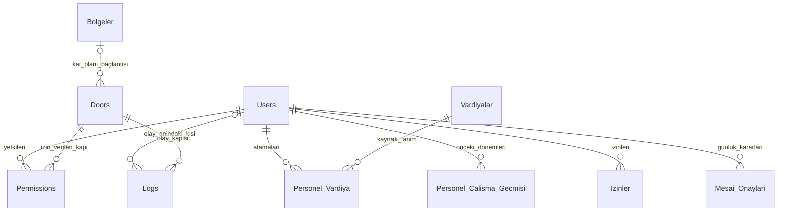

# V1 veri modeli

Şema `database/migrations` altındaki sıralı PostgreSQL dosyalarıyla kurulur. Adlar tırnaksız, yani veritabanında küçük harflidir (`users`, `ad_soyad`); API yine aşağıdaki yazımla (`Users`, `Ad_Soyad`) döner. Migration aracı uygulanan dosyanın adını ve checksum değerini saklar; değiştirilen eski migration'ı sessizce yeniden uygulamaz. Demo seed şema migration'ından ayrıdır.

| Tablo | Sorumluluk ve önemli sınır |
|---|---|
| `Users` | Personel kimliği, güncel kart, şirket/departman ve güncel çalışma dönemi. Panel hesabı değildir. Kart, TC ve sicil tekilliği migration kısıtlarıyla korunur; kart ve sicil büyük/küçük harf duyarsız tekildir. |
| `Doors` | Sentetik geçiş noktası, kapı türü ve aktiflik. Fiziksel röle/turnike sürücüsü yoktur. |
| `Bolgeler` | Kat planındaki dikdörtgen bölgeler (ad, tür, 2000 × 2000 ızgarada konum ve boyut). Kapılar `Doors.Plan_X/Plan_Y` ile bölge sınırına yerleştirilir ve `Bolge_A_ID`/`Bolge_B_ID` ile iki bölgeyi bağlar; boş taraf bina dışıdır. Bölge silinirse kapının o tarafı boşalır. |
| `Permissions` | Personel–kapı çoktan çoğa ilişkisi. Aynı çift yinelenemez. Kapıyı pasife almak mevcut izinlerini kaldırır; tekrar aktifleştirmek izinleri geri getirmez. |
| `Vardiyalar` | Saatler, tolerans, mola hakkı, haftanın çalışma günleri ve aktiflik. |
| `Personel_Vardiya` | Tarihli personel ataması ve atama anındaki vardiya alanlarının kopyası. Rapor tanımın güncel saatleri yerine bu kopyayı kullanır. |
| `Personel_Calisma_Gecmisi` | Yeniden işe alımdan önce kapanan çalışma dönemleri. Çalışılmayan aralıklar geçmiş rapora eklenmez. |
| `Logs` | Kart, kapı, olay saati, başarılı/başarısız sonucu ve olay eklenirken belirlenen kişi. Tanımsız kartta kişi boş kalabilir; sonradan başka kişiye bağlanmaz. |
| `Izinler` | Başlangıç/bitiş dahil izin aralığı, tür, karar ve açıklama. Sağlık raporu dosyası veya izin bakiyesi modülü değildir. |
| `Mesai_Onaylari` | Personel/gün başına son mesai kararı, karar anındaki hesap, onaylanan süre ve aktör. Aynı personel/gün çifti tektir. |
| `Yoneticiler` | Adına rağmen hem `admin` hem `user` panel hesabı saklar. bcrypt hash'i ve oturum sürümü; kullanıcı adı büyük/küçük harf duyarsız tekildir; personelle birebir FK ilişkisi yoktur. |
| `SystemLogs` | İK, vardiya, hesap, izin ve mesai işlemlerinin aktör/metin geçmişi. Ad/sicil olay anındaki metindir; kişi tablosuna canlı FK olarak bağlı değildir. |
| `DoorLogs` | Kapı tanımı/yetki değişikliklerinin işlem geçmişi. Kart okutması olan `Logs` ile farklı amaç taşır. |

Kritik değişiklikler ile işlem geçmişi aynı transaction'a yazılır. Commit tamamlanmadan Socket.IO bildirimi gönderilmez. İstemci bildirimi veri olarak kullanmaz; yetkili API'den listeyi tekrar alır. Personel güncellemelerinde kilitler, toplu hata durumunda geri alma ve mesai/izin çakışma testleri bu sınırları doğrular.

## Migration sırası

1. `001_initial.sql`: bütün tablolar, ilişkiler, tekillik kısıtları, indeksler, arama için `unaccent` eklentisi ve `gks_search()` fonksiyonu, geçişte kart sahibini (`Logs.User_ID`) ve atamada vardiya alanlarını (`Personel_Vardiya.Snapshot_*`) dolduran iki `BEFORE INSERT` trigger'ı.

2. `002_sandbox.sql`: public demodaki kişisel simülasyon alanlarının kaydı (`GksSandboxes`: şema adı, oluşturma ve bitiş zamanı). Alanlar aynı migration dosyalarıyla ayrı bir `sbx_<16 hex>` şemasına kurulur, iş tabloları demo verisinden kopyalanır (`Logs.User_ID` korunur) ve tablo başına satır kotası uygulanır; hesaplar (`Yoneticiler`) ve migration/seed metadatası kopyalanmaz. Bu yüzden migration'lar şema adı yazmadan (yalnız `public.unaccent` hariç) tırnaksız nesnelerle kalmalıdır.

`001_initial.sql` önceki SQL Server sürümünün beş migration'ından sonraki son şemanın PostgreSQL karşılığıdır; eski veriyi dönüştüren adımları içermez. Veritabanı `db:init` ile UTF-8, `tr-TR` ICU sıralaması ve `BUSINESS_TIMEZONE` varsayılan saat dilimiyle oluşturulur. Sonraki şema değişiklikleri yeni numaralı dosyalarla eklenir; uygulanmış dosya değiştirilmez. Personel adı/departmanı ve kapı türü için ayrı tarihsel sürüm tablosu yoktur. Ayrıntılı davranış [hesaplama kurallarında](V1-hesaplama-kurallari.md) ve [README'deki geçmiş sözleşmesinde](../README.md) açıklanır.

3. `003_kat_plani.sql`: kat planı. `Bolgeler` tablosu ve `Doors` tablosuna yerleşim kolonları (`Plan_X`, `Plan_Y`, `Bolge_A_ID`, `Bolge_B_ID`; hepsi boş başlar, mevcut kapılar ve kurulumlar etkilenmez). Kısıtlar: koordinatlar 0–2000, bölge en az 40 × 40, yerleşmemiş kapı bölgeye bağlanamaz, kapı aynı bölgeyi kendisine bağlayamaz. Simülasyon alanlarında `Bolgeler` de demo verisinden kopyalanır (kota 30).
